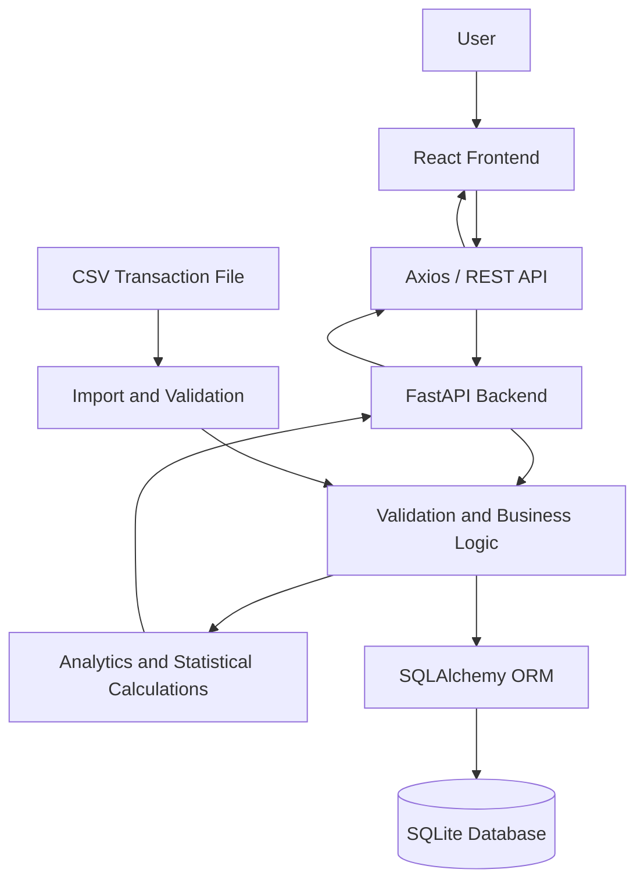

# PricePulse — Intelligent Pricing & Profit Analytics Platform

**An end-to-end data analytics platform for product pricing, profitability analysis, demand insights, and data-driven business decisions.**

PricePulse helps businesses understand how product prices, discounts, costs, and sales volumes affect revenue and profitability. It combines interactive analytics dashboards with statistical price elasticity analysis, pricing scenarios, break-even calculations, and CSV data imports.

The project demonstrates practical skills in **Python, SQL, data analytics, statistical modeling, FastAPI, React, and business intelligence**.

[](https://www.python.org/)
[](https://fastapi.tiangolo.com/)
[](https://react.dev/)
[](https://vitejs.dev/)
[](https://tailwindcss.com/)
[](LICENSE)

---

## Overview

PricePulse is a full-stack pricing and profit analytics application designed to turn sales transaction data into actionable business insights.

The platform brings together sales performance monitoring, product-level profitability analysis, discount tracking, price elasticity estimation, and pricing scenario simulation in one interface.

Instead of relying only on total sales, users can explore the relationship between revenue, costs, margins, discounts, and demand to make more informed pricing decisions.

### Project Highlights

- Interactive sales and profitability dashboard
- Product-level revenue, cost, and margin analysis
- Statistical price elasticity estimation
- Pricing and break-even scenario simulation
- CSV transaction data import and validation
- REST API built with FastAPI
- React-based analytics interface
- Database-backed product and transaction records
- Automated backend and frontend testing

## Business Problem

Businesses can generate substantial sales while still experiencing low profitability because of excessive discounts, high product costs, or ineffective pricing decisions.

Common challenges include:

- Identifying products with high sales but low profit margins
- Understanding the financial impact of discounts
- Comparing performance across product categories and sales channels
- Estimating how demand may respond to price changes
- Determining the sales volume required to break even
- Importing sales data without introducing invalid or inconsistent records

PricePulse addresses these challenges by combining transaction-level data, financial calculations, statistical analysis, and interactive reporting.

## Key Features

### 1. Sales and Profitability Dashboard

Monitor important business performance indicators in one place.

- Total revenue and units sold
- Cost of goods sold and gross profit
- Gross profit margin
- Average selling price
- Discount expenditure
- Sales trends and category comparisons
- Product and channel performance

### 2. Product Explorer

Analyze individual products and compare their commercial performance.

- Product-level revenue and sales volume
- Product costs and gross profit
- Profit margin comparisons
- Category-level performance
- Discount and pricing information
- Identification of high-revenue and low-margin products

### 3. Pricing and Demand Analysis

Explore historical pricing and sales relationships to support pricing decisions.

- Price and demand relationship analysis
- Statistical price elasticity estimation
- Model diagnostics and confidence intervals, where supported by the available data
- Data-quality checks for insufficient or unsuitable observations
- Identification of products that require more data before reliable analysis

**Important:** Historical price-demand relationships do not necessarily establish causation. Results should be interpreted alongside promotions, seasonality, competition, and other demand drivers.

### 4. Pricing Scenario Simulator

Evaluate hypothetical pricing changes before applying them to a business.

- Adjust product prices and discount assumptions
- Compare baseline and proposed scenarios
- Estimate revenue and gross profit under alternative assumptions
- Calculate break-even sales volume when the required inputs are available
- Understand the trade-off between sales volume, revenue, and profitability

Scenario results are estimates based on the selected assumptions, not guaranteed future outcomes.

### 5. CSV Data Import

Import transaction data for analysis.

- Upload sales transaction CSV files
- Validate required columns and values
- Detect invalid or incomplete records
- Process valid transactions
- Maintain import records and data-quality information
- Support safe handling of failed imports and database transactions, where implemented

### 6. Data Quality and Validation

Improve the reliability of business reporting through data validation.

- Validate transaction fields and numeric values
- Handle missing or invalid data
- Identify incomplete data that may affect calculations
- Prevent unsuitable data from being used in unsupported analyses
- Communicate when more observations are required

### 7. REST API

The FastAPI backend exposes application functionality through structured API endpoints.

- Request validation using Pydantic
- Database access through SQLAlchemy
- Structured JSON responses
- Interactive API documentation
- Centralized backend logic for analytics and business calculations

### 8. Database-Driven Analytics

Store and retrieve product and transaction information through a relational database.

- SQLite for straightforward local development
- Database configuration through environment variables
- Persistent product and transaction records
- Seed data for initial exploration
- PostgreSQL compatibility only where the application's models, driver, and database configuration support it

---

## Technology Stack

| Category | Technologies |
|---|---|
| Programming Languages | Python, JavaScript, SQL |
| Frontend | React 18, Vite 5 |
| Styling | Tailwind CSS |
| Routing | React Router |
| API Communication | Axios, REST APIs |
| Data Visualization | Recharts |
| Backend | FastAPI, Uvicorn |
| Data Validation | Pydantic |
| ORM | SQLAlchemy |
| Data Analysis | Pandas, NumPy |
| Statistical Analysis | SciPy and related statistical tools, where used |
| Database | SQLite |
| Testing | Pytest, Vitest, React Testing Library |
| Development Tools | Git, GitHub, VS Code, Postman |

---

## System Architecture

PricePulse follows a frontend-backend architecture.



### How It Works

1. Users interact with the React dashboard.
2. The frontend sends HTTP requests to the FastAPI backend.
3. The backend validates requests and processes business logic.
4. SQLAlchemy retrieves or updates database records.
5. Analytics functions calculate financial metrics and statistical results.
6. The API returns structured responses.
7. React displays the results through dashboard cards, charts, and tables.

---

## Analytics and Business Formulas

PricePulse uses standard business metrics to interpret product and transaction data.

### Revenue

Revenue is calculated from the selling price and quantity sold.

\[
\text{Revenue}=\sum(\text{Selling Price}\times\text{Quantity})
\]

### Cost of Goods Sold

\[
\text{COGS}=\sum(\text{Cost per Unit}\times\text{Quantity})
\]

### Gross Profit

\[
\text{Gross Profit}=\text{Revenue}-\text{COGS}
\]

### Gross Profit Margin

\[
\text{Gross Margin}=
\frac{\text{Gross Profit}}{\text{Revenue}}\times100
\]

### Average Selling Price

\[
\text{ASP}=
\frac{\text{Revenue}}{\text{Total Units Sold}}
\]

### Discount Expenditure

When the recorded selling price is the pre-discount list price:

\[
\text{Discount Spend}=
\sum(\text{List Price}\times\text{Discount Rate}\times\text{Quantity})
\]

The precise calculation depends on how the source dataset represents list prices, selling prices, and discounts.

### Price Elasticity of Demand

A common statistical approach estimates the relationship between price and quantity using a log-log model:

\[
\ln(Q)=\alpha+\beta\ln(P)+\varepsilon
\]

Where:

- \(Q\) = quantity demanded
- \(P\) = product price
- \(\alpha\) = intercept
- \(\beta\) = estimated price elasticity coefficient
- \(\varepsilon\) = unexplained variation

A negative coefficient generally indicates an inverse relationship between price and quantity in the analyzed data.

Elasticity estimates are meaningful only when the data and model assumptions are suitable. Promotions, seasonality, product availability, and other factors can influence the relationship.

### Break-Even Sales Volume

For a simplified single-product model:

\[
\text{Break-even Units}=
\frac{\text{Fixed Costs}}{\text{Selling Price}-\text{Variable Cost per Unit}}
\]

This calculation requires positive contribution per unit and appropriate cost inputs. It should not be interpreted as a complete company-wide break-even analysis unless all relevant fixed and variable costs are included.

---

## Project Structure

```text
PricePulse/
│
├── backend/
│   ├── app/
│   │   ├── main.py
│   │   ├── database.py
│   │   ├── seed_data.py
│   │   └── ...
│   │
│   ├── tests/
│   │   └── ...
│   │
│   └── requirements.txt
│
├── frontend/
│   ├── public/
│   ├── src/
│   │   ├── components/
│   │   ├── pages/
│   │   ├── services/
│   │   └── ...
│   │
│   ├── package.json
│   └── vite.config.js
│
├── scripts/
│   ├── setup.ps1
│   ├── run_backend.ps1
│   └── run_frontend.ps1
│
├── .env.example
├── .gitignore
└── README.md
```

*The structure above summarizes the main areas of the project. Individual module and filename details may vary as the application evolves.*

---

## Getting Started

Follow these instructions to run PricePulse locally on Windows.

### Prerequisites

Install the following tools:

- Python 3.11 or a compatible version supported by the project's dependencies
- Node.js and npm
- Git
- A code editor such as Visual Studio Code

Check your installations:

```powershell
python --version
node --version
npm --version
git --version
```

### 1. Clone the Repository

```powershell
git clone https://github.com/Prachi-Ukey/PricePulse.git
cd PricePulse
```

### 2. Run the Setup Script

From the project root, run:

```powershell
powershell -ExecutionPolicy Bypass -File .\scripts\setup.ps1
```

The setup script is intended to:

- Create a `.env` file from `.env.example` if one does not exist
- Create a Python virtual environment in `.venv`
- Install backend dependencies
- Install frontend dependencies
- Initialize database tables
- Seed the database if it is empty

If setup fails, review the terminal output before proceeding.

### 3. Start the Backend

Open a PowerShell terminal in the project root:

```powershell
powershell -ExecutionPolicy Bypass -File .\scripts\run_backend.ps1
```

Backend base URL:

```text
http://127.0.0.1:8000
```

API documentation:

```text
http://127.0.0.1:8000/docs
```

Health endpoint:

```text
http://127.0.0.1:8000/api/health
```

### 4. Start the Frontend

Open a **second PowerShell terminal** in the project root:

```powershell
powershell -ExecutionPolicy Bypass -File .\scripts\run_frontend.ps1
```

Open the frontend in your browser:

```text
http://localhost:5173
```

Keep both terminals running while using the application.

---

## Environment Configuration

The repository includes an `.env.example` file containing the default development configuration.

Example:

```env
HOST=127.0.0.1
PORT=8000
ENVIRONMENT=development

CORS_ORIGINS=http://localhost:5173,http://127.0.0.1:5173

DATABASE_URL=sqlite:///./pricepulse.db

AUTO_SEED_ON_STARTUP=true
SEED_PRODUCT_COUNT=100
SEED_TRANSACTION_COUNT=5000

VITE_API_BASE_URL=http://127.0.0.1:8000/api
```

### Configuration Notes

- `HOST` and `PORT` configure the backend server.
- `CORS_ORIGINS` lists the frontend origins allowed to access the API.
- `DATABASE_URL` specifies the database connection.
- `AUTO_SEED_ON_STARTUP` controls automatic seeding if supported by the application startup logic.
- `SEED_PRODUCT_COUNT` and `SEED_TRANSACTION_COUNT` configure the seed dataset where those settings are consumed by the code.
- `VITE_API_BASE_URL` specifies the API base URL used by the frontend.

The `.env` file is intended for local configuration and should not be committed. Only commit `.env.example` with safe, non-secret defaults.

**Database note:** SQLite relative paths are resolved in relation to the application's working directory or configured database path. If you change directories when starting the backend, confirm which database file the application uses.

---

## Testing

PricePulse includes backend and frontend test infrastructure.

### Backend Tests

From the project root:

```powershell
.\.venv\Scripts\python.exe -m pytest backend\tests -v
```

This runs the backend test suite using Pytest.

### Frontend Tests

```powershell
cd frontend
npm test
```

The configured frontend test script runs Vitest.

### Frontend Production Build

From the `frontend` directory:

```powershell
npm run build
```

To return to the project root:

```powershell
cd ..
```

Review the test output and resolve any failures before considering a build or release ready.

---

## Sample Data

PricePulse supports seed data for exploring the analytics workflow without requiring a real company's private sales data.

The seed configuration is designed to generate product and transaction records for dashboard and analysis scenarios.

Seed data can help demonstrate:

- Revenue and profitability trends
- Product-level comparisons
- Category and channel analysis
- Discount calculations
- Pricing analysis workflows
- Data import and validation

**Data disclaimer:** Synthetic data is useful for demonstrating application functionality, but it is not evidence of actual commercial performance. Results generated from synthetic data should not be presented as real business outcomes.

For meaningful business analysis, use a representative dataset with reliable product costs, transaction prices, quantities, discounts, dates, and relevant demand drivers.

---

## API Documentation

FastAPI provides interactive API documentation when the backend is running.

- **Swagger UI:** `http://127.0.0.1:8000/docs`
- **OpenAPI schema:** `http://127.0.0.1:8000/openapi.json`
- **Health check:** `http://127.0.0.1:8000/api/health`

Use Swagger UI to inspect available endpoints, review request and response schemas, and test API operations.

The health endpoint should be used to verify backend availability. Actual endpoint paths and supported operations are defined by the backend implementation.

---

## Limitations and Assumptions

- Pricing and demand analysis depends on the quality and coverage of historical data.
- Correlation between price and demand does not prove that a price change caused a change in sales.
- Statistical estimates can be unreliable when there are too few observations or insufficient price variation.
- Scenario simulations depend on the assumptions and inputs supplied by the user.
- Forecasts and scenario outputs are estimates rather than guaranteed results.
- Synthetic seed data does not represent a real company's financial performance.
- SQLite is intended for convenient local development; production deployment may require a different database and operational setup.
- PostgreSQL support should be considered available only when the database driver, schema, migrations, and application configuration have been verified for that environment.

---

## Future Improvements

Potential areas for future development include:

- Time-series demand forecasting
- Promotion and seasonality analysis
- Competitor price comparison
- Customer and product segmentation
- Automated pricing recommendations with explainable assumptions
- Role-based access control
- Scheduled ingestion of sales data
- PostgreSQL production deployment
- Docker-based deployment and CI/CD
- Improved monitoring, logging, and error reporting
- More comprehensive integration and end-to-end tests
- Exportable reports for business stakeholders

---

## What I Learned

Building PricePulse provides practical experience with:

- Developing a full-stack application using React and FastAPI
- Designing REST APIs and validating requests
- Connecting Python applications to relational databases
- Cleaning and validating transaction data
- Calculating financial and profitability metrics
- Applying statistical methods to pricing and demand questions
- Designing interactive dashboards and visualizations
- Writing automated backend and frontend tests
- Managing project configuration and source control with Git
- Translating business questions into measurable analytical outputs

---

## Author

**Prachi Ukey**

B.E. Computer Engineering | 2026 Graduate

Interested in Data Analytics, Python Development, Full-Stack Development, and AI-powered applications.

- GitHub: [Prachi-Ukey](https://github.com/Prachi-Ukey)
- LinkedIn: [Prachi Ukey](https://www.linkedin.com/in/prachi-ukey-02573b2a2/)

---
